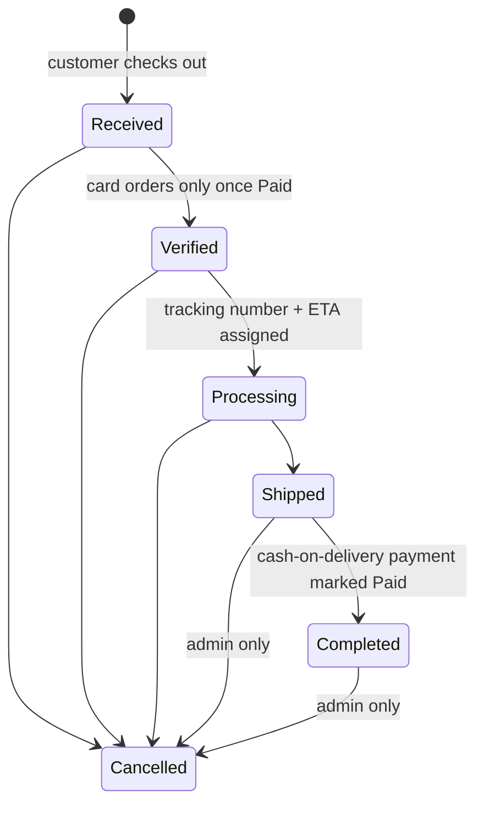

# Admin guide

The admin panel lives in the `Admin` area (`Areas/Admin`) and is available at **`/Admin`**. Every admin controller has `[Authorize(Roles = "Admin")]` (most via the `DbInitializer.AdminRole` constant). Anonymous visitors are sent to `/Identity/Account/Login`; signed-in users without the role get `/Error/AccessDenied`. The area uses its own layout (`Areas/Admin/Views/Shared/_LayoutAdmin.cshtml`, Bootstrap 5 + Font Awesome) with a sidebar grouped into Sales, Catalog, Customers and Settings. The sidebar shows badges for orders in `Received` status and for reviews awaiting moderation.

All `POST` actions are protected by the global `AutoValidateAntiforgeryTokenAttribute`. The layout writes the token into `<meta name="csrf-token">` and `wwwroot/js/site.js` adds it as the `X-CSRF-TOKEN` header to same-origin `fetch`/jQuery requests, so the AJAX actions below work without a hidden form field.

## Getting access

On startup `DbInitializer` creates the `Admin` and `User` roles and seeds an admin account from the `SeedData` configuration section (see [Configuration](configuration.md)):

- The account is created **only** if no user with `SeedData:AdminEmail` exists **and** `SeedData:AdminPassword` is set. Otherwise a warning is logged and no admin is created.
- If the user already exists, the seeder only makes sure it is in the `Admin` role and has a confirmed email. An existing password is never overwritten.

To make another user an admin, open **Customers → Roles** for that user and add the `Admin` role.

## Dashboard — `HomeController.Index`

`GET /Admin` shows (orders with status `Cancelled` are excluded from all revenue figures):

| Card / panel | Source |
| --- | --- |
| Total revenue, revenue last 30 days | Sum of `TotalAmount` of non-cancelled orders |
| Orders, orders last 30 days | Count of all orders |
| Open orders | Orders in `Received`, `Verified` or `Processing` |
| Customers | Count of all user accounts |
| Active products | Products with `IsActive` |
| Pending reviews | Reviews with `IsApproved = false` |
| Messages, newsletter subscribers | Row counts of `Contacts` and `NewsletterSubscribers` |
| Orders by status | Count per status, each linking to the filtered order list |
| Sales by day | Orders and revenue for each of the last 14 days (UTC) |
| Top products | Top 5 by units sold in non-cancelled orders |
| Recent orders | Latest 8 orders |
| Low stock | Up to 8 active products with stock ≤ 5, lowest first |

## Orders — `OrdersController`

### Viewing
- `GET /Admin/Orders?status=&search=&page=` — 25 orders per page, newest first, with a tab per status and its count. `search` matches the exact order ID (an `ORD`-prefixed order number also works; its leading zeros are ignored), customer name, order email, account email, phone or tracking number.
- `GET /Admin/Orders/Details/{id}` — items, customer and shipping address, customer comment, estimated delivery, status timeline and tracking history, plus the **Update order** and **Add tracking update** forms.
- `GET /Admin/Orders/Invoice/{id}` — printable invoice (reuses `Views/Orders/Invoice.cshtml`; shows the VAT included in the total using `Store:VatRate`).

### Excel export (EPPlus)
`GET /Admin/Orders/ExportToExcel?status=&search=` downloads `orders-yyyyMMdd-HHmm.xlsx` (UTC) with the same filters as the list but without paging. The `Orders` sheet has 22 columns: order number, date, customer, email, phone, address, city, postal code, country, status, payment method, payment status, subtotal, discount, coupon, shipping, total, tracking number, carrier, items, customer comment and admin notes. The action sets `ExcelPackage.LicenseContext = LicenseContext.NonCommercial` and writes an `EXPORT_ORDERS` audit entry.

### Order lifecycle

The status dropdown on the details page offers every status, so admins can move an order forwards or backwards freely. The one enforced rule is that **a cancelled order can't be reopened** (its stock has already been returned); the dropdown is disabled for cancelled orders and the server rejects the change. Customers can cancel their own orders only before `Shipped`.

### Updating status
`POST /Admin/Orders/UpdateStatus` with `id`, `status`, and optional `trackingNumber`, `adminNotes`, `carrier` (sent by the details page via `fetch`). Returns JSON `{ success, message }`. Inside a database transaction (wrapped in the EF execution strategy) it:

1. Rejects unknown statuses and any change away from `Cancelled`. For **card orders**, it also:
   - rejects moving the order past `Received` until the payment is `Paid`;
   - before cancelling an order that is still awaiting payment, closes the provider's payment session first. If the customer has just paid, it refuses and asks staff to wait for the confirmation.
2. Sets the status. `adminNotes`, `carrier` and `trackingNumber` overwrite the stored values only when non-empty (truncated to 2000/100/100 characters).
3. For **Processing** or **Shipped**: generates a tracking number if the order has none (`HS` + 6-digit order ID + `yyMMdd` + 6 random hex characters) and sets `EstimatedDelivery` to 4 business days from now if not already set.
4. Sets the matching date field once (`VerifiedDate`, `ProcessingDate`, `ShippedDate`, `CompletedDate`, `CancelledDate`).
5. **Completed**: if the payment method is cash on delivery and the payment status is `Pending`, sets the payment status to `Paid`. Card orders are never marked paid here; only the provider's webhook does that.
6. **Cancelled**: sets a `Pending` payment status to `Cancelled`. For a card order that was `Paid` or `RequiresReview`, it sets `RefundDue`; the success message names the transaction to refund in the provider dashboard. It then calls `OrderService.RestockCancelledOrderAsync`, which **adds every line's quantity back to product stock** and decrements the coupon's `TimesUsed` if the order used one.
7. If the status actually changed, adds a milestone tracking event (location `HikingStore`, e.g. "Order handed to the carrier").

After the commit it:

- Writes a `MODIFY_STATUS_UPDATE` audit entry (old → new status).
- Sends the SignalR event `OrderStatusUpdated` on `/realtimeHub` to the groups `User_{customerId}` and `Order_{orderId}` with `{ orderId, status, oldStatus, trackingNumber, message }`. It is **not** sent to the `Admins` group. See [Real-time](realtime.md).
- If the status changed, queues a status email to the customer through `OrderEmailService` (English HTML email with the order summary and a link to `/Orders/Details/{id}`). It is sent in the background with its own DI scope; failures are only logged. **No admin copy is sent for admin-initiated changes** (`notifyAdmin: false`); the copy to `EmailSettings:AdminEmail` is only sent when a *customer* cancels an order.

Saving with an unchanged status still updates notes/carrier/tracking and still pushes the SignalR event, but sends no email and adds no tracking event.

### Tracking events
- `POST /Admin/Orders/AddTrackingEvent` — `orderId`, `location`, `status`, `description` (all required, max 100/100/500 characters), `isMilestone`. JSON response.
- `GET /Admin/Orders/GetTrackingHistory?orderId=` — returns the `Views/Orders/_TrackingHistory.cshtml` partial.

There is no action to delete orders from the admin panel.

## Coupons — `CouponsController`

| Action | URL | What it does |
| --- | --- | --- |
| List | `GET /Admin/Coupons` | All coupons, newest first |
| Create | `GET/POST /Admin/Coupons/Create` | Shared `Form` view |
| Edit | `GET/POST /Admin/Coupons/Edit/{id}` | `TimesUsed` is never changed by the form |
| Toggle active | `POST /Admin/Coupons/ToggleActive/{id}` | Activates/deactivates |
| Delete | `POST /Admin/Coupons/Delete/{id}` | If the coupon has been used (`TimesUsed > 0` or any order has its code) it is **deactivated instead** |

Fields: code, description, discount type (`Percentage` or `FixedAmount`), value, minimum order subtotal, maximum discount, valid from / expires (UTC), total usage limit, uses per customer (default 1), active. Validation: codes are normalised by `CouponService.Normalize`, must be 3–40 letters, digits, `-` or `_`, and unique; a percentage can't exceed 100; expiry must be after start. Zero or empty minimum/maximum amounts are stored as "no limit". Create, update and delete are audit-logged.

## Reports — `ReportsController`

- `GET /Admin/Reports?from=&to=` — defaults to the last 30 days; the range is capped at 366 days (dates are swapped if reversed). Shows non-cancelled order count, cancelled count, revenue, discounts given, shipping collected, new customers (users whose first order falls in the range), daily sales, top 10 products by revenue, sales by category and coupon usage. The page has quick-range buttons. There is no Excel export here; use the orders export instead.
- `GET /Admin/Reports/Newsletter` — newsletter subscribers, newest first.
- `GET /Admin/Reports/NewsletterCsv` — downloads `newsletter-yyyyMMdd.csv` (`Email,SubscribedUtc`). Values starting with `= + - @`, tab or CR are prefixed with `'` to prevent spreadsheet formula injection.
- `POST /Admin/Reports/DeleteSubscriber/{id}` — removes a subscriber.

## Products — `ProductsController`

- **List**: `GET /Admin/Products?search=&category=&stock=&status=&page=` — 25 per page. `search` matches name, brand or exact ID; `stock` is `out` (≤ 0) or `low` (1–5); `status` is `active`, `hidden` or `sale` (compare-at price above price).
- **Create / Edit** (`Form` view, `multipart/form-data`): name, description, price, compare-at ("original") price, brand, material, specifications, sizes and colours (comma-separated; trimmed, de-duplicated, max 50 characters each), stock (negative values become 0), category (sub-categories shown as `Parent › Child`), active, featured.
  - A main image is **required** on create. On edit, uploading a new one replaces the file and deletes the old one.
  - Up to 8 gallery images can be added per save; a failed gallery file is skipped and reported, the rest of the save succeeds. On edit, ticked gallery images (`removeImages`) are deleted from disk.
  - The compare-at price must be higher than the price, or empty.
  - Create and update are audit-logged (price changes include old and new price).
- **Update stock** (AJAX from the list): `POST /Admin/Products/UpdateStock` with `id` and `stockQuantity` (0–1,000,000). JSON response, audit-logged.
- **Show / hide**: `POST /Admin/Products/ToggleActive/{id}`.
- **Delete**: `POST /Admin/Products/Delete/{id}`. If the product appears in any order it is **hidden instead** (`IsActive = false`) and removed from all carts. Otherwise it is deleted together with its image files, and the deletion is audit-logged.

Stock is decreased atomically at checkout and returned when an order is cancelled (by the customer or by an admin).

### Image uploads — `ImageUploadService`

Used for product and category images.

- Maximum size **5 MB** per file (`MaxFileSizeBytes`).
- Allowed types: **JPEG, PNG, GIF and WebP**, detected from the file's first 12 bytes (magic numbers). The browser's file name and content type are ignored.
- Files are saved as `{random GUID}{.jpg|.png|.gif|.webp}` in `wwwroot/Product/` (products) or `wwwroot/category/` (categories); the folder is created if missing. Paths are built with `Path.Combine` from `WebRootPath`.
- `Delete` only accepts bare file names (no path segments) and logs, rather than throws, on I/O errors.

## Categories — `CategoriesController`

- **List**: `GET /Admin/Categories` — top-level categories first, then by display order and name, with product counts.
- **Create / Edit** (`Form` view): name (unique), description, optional parent, display order, optional image (same rules as above; replacing an image deletes the old file).
- Categories are at most two levels deep: a parent must itself be top-level, a category can't be its own parent, and a category that has children must stay top-level.
- **Delete** (`POST /Admin/Categories/Delete/{id}`): refused while the category has sub-categories or products; otherwise the category and its image are deleted.
- Every successful `POST` clears the cached storefront navigation (`CatalogService.NavigationCacheKey`), so menu changes appear immediately. Create, update and delete are audit-logged.

## Reviews — `ReviewsController`

- `GET /Admin/Reviews?status=pending|approved|all&page=` — 30 per page, newest first; defaults to `pending`.
- `POST /Admin/Reviews/Approve/{id}` — publishes the review.
- `POST /Admin/Reviews/Unpublish/{id}` — hides an approved review.
- `POST /Admin/Reviews/Delete/{id}` — deletes it permanently.

All three are audit-logged and return to the same filter tab.

## Wishlists — `WishlistController`

- `GET /Admin/Wishlist?userId=&search=` — every wishlist entry, newest first, filterable by user; `search` matches product name, username or email.
- `POST /Admin/Wishlist/Delete/{id}` — removes one entry (JSON response).
- `GET /Admin/Wishlist/Statistics` — total entries, number of distinct users, and the 10 most-wished products.

## Customers (users) — `HomeController`

| Action | URL | What it does |
| --- | --- | --- |
| List | `GET /Admin/Home/Users?search=` | Users with name, email, roles, order count, locked / unconfirmed-email badges. Search matches email, username, first or last name |
| Roles | `GET /Admin/Home/EditRole?userId=` | The user's current roles and a picker of all roles |
| Add role | `POST /Admin/Home/EditRole` (`UserId`, `RoleId`) | Adds the role and updates the security stamp |
| Remove role | `POST /Admin/Home/RemoveRole` (`roleName`, `userId`) | Removes the role and updates the security stamp. You can't remove your own `Admin` role |
| Lock | `POST /Admin/Home/LockUser?userId=` | Enables lockout, sets the lockout end 100 years ahead and updates the security stamp. Not allowed on yourself |
| Unlock | `POST /Admin/Home/UnlockUser?userId=` | Clears the lockout end and resets the failed-login count |
| Delete | `POST /Admin/Home/DeleteUser?userId=` | Refused for yourself and for any user who has orders (lock them instead). Otherwise removes their cart, wishlist, chat messages they sent in other users' rooms, and un-assigns them as chat agent, then deletes the account |

Role, lock, unlock and delete actions are audit-logged. Updating the security stamp invalidates the user's existing cookies the next time Identity re-validates them.

## Roles — `RoleManagerController`

Uses ASP.NET Core Identity's `RoleManager<IdentityRole>`.

| Action | URL |
| --- | --- |
| List roles | `GET /Admin/RoleManager` |
| Create role (2–50 characters, must not exist) | `POST /Admin/RoleManager/CreateRole` |
| View members / rename | `GET /Admin/RoleManager/EditRole/{id}`, `POST /Admin/RoleManager/EditRoleConfirmed/{id}` |
| Delete role | `POST /Admin/RoleManager/RemoveRole/{id}` |

The built-in `Admin` and `User` roles can't be renamed or deleted; the code refers to them by name. Users are added to or removed from roles on the Customers page. Create, rename and delete are audit-logged.

## Contact messages — `HomeController.ShowMessage`

- `GET /Admin/Home/ShowMessage` — contact-form submissions, newest first.
- `POST /Admin/Home/SendReply` (`id`, `replySubject`, `replyMessage`) — emails the reply to the sender through `IEmailSender` (the message is HTML-encoded), audit-logs `CONTACT_REPLY` and returns JSON. If sending fails the error is logged and the admin sees "The email could not be sent".
- `POST /Admin/Home/DeleteMessage` (`id`) — deletes the message (JSON response).

## Newsletter subscribers

See [Reports](#reports--reportscontroller): list, CSV export and delete live in `ReportsController`.

## Support chat — `ChatController`

- `GET /Admin/Chat` — all chat rooms, most recent activity first. The page polls `GetUnreadCount` for its badge.
- `GET /Admin/Chat/Room/{id}` — opens a room. If no agent is assigned, the current admin is assigned and the room becomes `InProgress`. Messages from anyone else are marked read. The page connects to `/chatHub` (`JoinRoom`, `SendMessage`, `Typing`) for live messaging.
- `POST ResolveRoom/{id}`, `CloseRoom/{id}` — set `Resolved` / `Closed` and `ResolvedAt`.
- `POST ReopenRoom/{id}` — sets a resolved or closed room back to `InProgress`.
- `POST DeleteRoom/{id}` — only for `Resolved` or `Closed` rooms; deletes the room and its messages.
- `POST AssignAgent/{id}` (`agentId`) — assigns a specific agent; not linked from any view.
- `GET /Admin/Chat/GetUnreadCount` — JSON `{ count }`: number of rooms with unread customer (non-agent) messages.

Admins connected to `/chatHub` join the `Agents` group and receive `NewUserMessage` notifications for every customer message. See [Real-time](realtime.md).

## Test email — `TestEmailController`

`/TestEmail` (Admin only, outside the Admin area; linked from the sidebar as **Email test**) sends a test message through `IEmailSender`. If the app is using `DevelopmentEmailSender` (Development without an SMTP password) it refuses and explains that emails are only being logged. SMTP errors are shown on the page.

## Audit logging

`AdminAuditService` writes `ADMIN_AUDIT:` warnings (action, admin name and ID, details, target, IP, user agent, UTC timestamp) to the application log for the actions marked "audit-logged" above. Nothing is stored in the database, so configure a persistent log sink in production if you need an audit trail.
