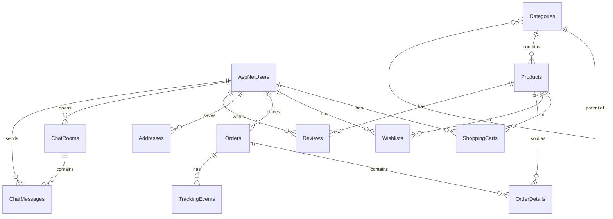

# Data model

All entities live in `ApplicationDbContext` (`Data/ApplicationDbContext.cs`), which extends `IdentityDbContext<ApplicationUser>`, so the standard Identity tables (`AspNetUsers`, `AspNetRoles`, `AspNetUserRoles`, etc.) are in the same SQL Server database.

## Entity relationship overview



`Coupons`, `NewsletterSubscribers` and `Contacts` have no foreign keys. Orders reference coupons only by `CouponCode` (string).

## `ApplicationUser`

Declared in `Data/ApplicationDbContext.cs` as `ApplicationUser : IdentityUser` and used by Identity, the context and all user navigations.

| Property | Notes |
| --- | --- |
| `FirstName`, `LastName` | `nvarchar(100)`, nullable, `[PersonalData]`. Columns added by `StorefrontRefinement` |
| `DisplayName` | Computed ("First Last", else user name, else email, else "Customer"); explicitly ignored by EF |

`ApplicationDbContext.RemoveNonCascadingUserDataAsync(userId)` deletes the rows whose user foreign keys do not cascade (cart rows, wishlist rows, chat messages the user sent in other users' rooms) and clears `ChatRooms.AgentId`, so the user can be deleted. Its callers (admin `DeleteUser` and the Identity `DeletePersonalData` page) refuse to delete users who have orders.

## Tables

### `Categories` (`Category`)
| Column | Type | Notes |
| --- | --- | --- |
| `CatId` | int, PK | |
| `CatName` | nvarchar(100) | Required |
| `CatPhoto` | string? | File name in `wwwroot/category/` |
| `Description` | nvarchar(500)? | |
| `ParentCatId` | int?, FK → `Categories` | Self-reference for subcategories; **Restrict** on delete; indexed |
| `DisplayOrder` | int | Default 0; ordering in navigation |

Navigations: `Parent`, `Children`, `Product`. `File` (`IFormFile`) is not mapped. The admin delete action refuses categories that still have subcategories or products.

### `Products` (`Product`)
| Column | Type | Notes |
| --- | --- | --- |
| `ProId` | int, PK | |
| `ProName` | nvarchar(200) | Required |
| `Descreption` | nvarchar(max) | Required (the misspelling is the real column name) |
| `Price` | decimal(18,2) | Required, 0.01–1,000,000; indexed |
| `CompareAtPrice` | decimal(18,2)? | Original price; on sale when greater than `Price` |
| `Brand` | nvarchar(100)? | Indexed |
| `Material` | nvarchar(200)? | |
| `Specifications` | nvarchar(4000)? | One `Name: Value` per line |
| `Sizes`, `Colors` | nvarchar(500)? | Comma-separated selectable options |
| `ProImage` | string? | Main image file name in `wwwroot/Product/` (nullable since `StorefrontRefinement`) |
| `AdditionalImages` | string? | Comma-separated extra image file names |
| `StockQuantity` | int | 0–1,000,000 |
| `IsActive` | bit | DB default `true`; inactive products are hidden from the storefront but kept for order history |
| `IsFeatured` | bit | Default `false`; homepage featured list |
| `CreatedAt` | datetime2 | DB default `GETUTCDATE()`; indexed |
| `CatId` | int, FK → `Categories` | **Cascade** on delete; indexed |

Indexes: `Price`, `CreatedAt`, `Brand`, `CatId`, and composite `(IsActive, CatId)`.

Computed, not mapped: `IsInStock`, `IsOnSale`, `DiscountPercent`, `SizeOptions`, `ColorOptions`, `AdditionalImageList`, `AllImagePaths` (main image then de-duplicated extras), `SpecificationList`; upload properties `File` and `GalleryFiles`. The admin delete action deactivates (rather than deletes) a product that appears in any order.

### `ShoppingCarts` (`ShoppingCart`)
One row per user, product and variant.

| Column | Type | Notes |
| --- | --- | --- |
| `CartId` | int, PK | |
| `ProId` | int, FK → `Products` | Cascade |
| `Qty` | int | Validation range 1–999 (`CartService` itself caps lines at 99) |
| `ShippingOption` | string? | Legacy column from `AddShippingOptionToShoppingCart`; no longer read or written by any code (shipping is chosen at checkout) |
| `SelectedSize`, `SelectedColor` | nvarchar(50)? | Chosen variant |
| `UserId` | string?, FK → `AspNetUsers` | Optional; no cascade (No Action) |

Unique index `(UserId, ProId, SelectedSize, SelectedColor)` filtered on `[UserId] IS NOT NULL`. Guest carts are not stored here; they live in session (see `SessionCartService`).

### `Wishlists` (`Wishlist`)
| Column | Type | Notes |
| --- | --- | --- |
| `WishlistId` | int, PK | |
| `ProId` | int, FK → `Products` | Cascade |
| `UserId` | string?, FK → `AspNetUsers` | No cascade (No Action) |
| `AddedDate` | DateTime | Defaults to `DateTime.UtcNow` |

Unique index `(UserId, ProId)` filtered on `[UserId] IS NOT NULL`.

### `Orders` (`Order`)
| Column | Type | Notes |
| --- | --- | --- |
| `OrderId` | int, PK | `OrderNumber` (not mapped) is `ORD{OrderId:D6}` |
| `UserId` | string, FK → `AspNetUsers` | Required, cascade |
| `OrderDate` | DateTime | UTC |
| `FullName` | nvarchar(100)? | Customer name at checkout |
| `Email` | nvarchar(256)? | Order email recipient |
| `ShippingAddress`, `City`, `PhoneNumber` | nvarchar(max) | Required |
| `PostalCode` | nvarchar(20)? | |
| `Country` | nvarchar(60)? | |
| `Comment` | string? | Customer note |
| `Subtotal` | decimal(18,2) | Sum of line totals |
| `DiscountAmount` | decimal(18,2) | Coupon discount |
| `ShippingCost` | decimal(18,2) | |
| `TotalAmount` | decimal(18,2) | `Subtotal − DiscountAmount + ShippingCost` |
| `CouponCode` | nvarchar(40)? | Set only when a discount was applied |
| `PaymentMethod` | nvarchar(30) | DB default `CashOnDelivery`; `CashOnDelivery` or `Card` (`PaymentMethods`) |
| `PaymentStatus` | nvarchar(30) | DB default `Pending`; values `Pending`, `Paid`, `Failed`, `Expired`, `Cancelled`, `RefundDue`, `RequiresReview`, `Refunded` (`PaymentStatuses`, see [Card payments](payments.md#payment-statuses)) |
| `PaymentProvider` | nvarchar? | `Stripe` or `HostedGateway` for card orders |
| `PaymentSessionId`, `PaymentTransactionId` | nvarchar? | Provider checkout session and payment (e.g. `cs_…`, `pi_…`); filtered indexes |
| `PaymentAttempts` | int | Default 0; incremented per hosted session, used as an optimistic-concurrency check |
| `PaymentExpiresAt` | DateTime? | Deadline for an unpaid card order; indexed with `PaymentStatus` |
| `PaidAmount`, `PaidAt` | decimal(18,2)?, DateTime? | Amount and time confirmed by the provider webhook |
| `PaymentFailureReason` | nvarchar? | Last decline/failure message from the provider |
| `CheckoutToken` | uniqueidentifier? | One-time checkout token; prevents duplicate orders |
| `Status` | `OrderStatus` (int) | Starts at `Received`; indexed |
| `VerifiedDate`, `ProcessingDate`, `ShippedDate`, `CompletedDate`, `CancelledDate` | DateTime? | Set on first transition to that status |
| `TrackingNumber` | string? | `null` at checkout; generated as `HS{OrderId:D6}{yyMMdd}{6 hex chars}` on Processing/Shipped unless the admin provides one |
| `Carrier`, `ShippingService` | string? | Both set to the chosen shipping method's name at checkout |
| `EstimatedDelivery` | DateTime? | 4 business days out when first moved to Processing/Shipped |
| `AdminNotes` | string? | |

Indexes: unique `CheckoutToken` (filtered `[CheckoutToken] IS NOT NULL`), `(UserId, OrderDate)`, `Status`. `CanBeCancelledByCustomer` (not mapped) is true before `Shipped` and when not already cancelled; for card orders, only while the payment is still `Pending`. `IsCardPayment` and `IsAwaitingCardPayment` are unmapped helpers. Card orders are marked `Paid` only by a verified provider webhook (`PaymentService`). Moving an order to `Completed` marks a pending cash-on-delivery payment `Paid`; cancelling marks a pending payment `Cancelled` and restocks items. Cancelled orders cannot be reopened.

### `OrderDetails` (`OrderDetail`)
| Column | Type | Notes |
| --- | --- | --- |
| `OrderDetailId` | int, PK | |
| `OrderId` | int, FK → `Orders` | Cascade |
| `ProId` | int, FK → `Products` | **Restrict**: a product with order lines cannot be deleted |
| `ProductName` | nvarchar(200)? | Name snapshot at purchase |
| `SelectedSize`, `SelectedColor` | nvarchar(50)? | Variant snapshot |
| `Quantity` | int | |
| `Price` | decimal(18,2) | Unit price charged at checkout |

Not mapped: `LineTotal`, `DisplayName` (`ProductName`, else current product name, else "Product").

### `TrackingEvents` (`TrackingEvent`)
Order history timeline. Checkout adds "Order placed"; every admin status change and every customer cancellation adds a milestone event.

| Column | Type |
| --- | --- |
| `TrackingEventId` | int, PK |
| `OrderId` | int, FK → `Orders` (cascade) |
| `EventDate` | DateTime |
| `Location`, `Status` | string, required |
| `Description` | string |
| `IsMilestone` | bool |

### `Reviews` (`Review`)
| Column | Type | Notes |
| --- | --- | --- |
| `ReviewId` | int, PK | |
| `ProId` | int, FK → `Products` | Cascade |
| `UserId` | string, FK → `AspNetUsers` | Cascade; indexed |
| `Rating` | int | 1–5 |
| `Title` | nvarchar(100) | Required, min 3 chars |
| `Comment` | nvarchar(2000) | Required, min 10 chars |
| `IsApproved` | bit | Only approved reviews are shown and counted; new reviews start unapproved |
| `IsVerifiedPurchase` | bit | Set when the reviewer has a `Completed` order containing the product |
| `CreatedAt` | datetime2 | UTC |

Indexes: unique `(ProId, UserId)` (one review per user per product), `(ProId, IsApproved)`. Only users with a non-cancelled order for the product may review it.

### `Coupons` (`Coupon`)
| Column | Type | Notes |
| --- | --- | --- |
| `CouponId` | int, PK | |
| `Code` | nvarchar(40) | Required, 3–40 chars of `A-Z a-z 0-9 _ -`; stored upper-cased; **unique** |
| `Description` | nvarchar(200)? | |
| `DiscountType` | `DiscountType` (int) | `Percentage` (0) or `FixedAmount` (1) |
| `Value` | decimal(18,2) | Percent or euro amount |
| `MinimumOrderAmount`, `MaxDiscountAmount` | decimal(18,2)? | |
| `StartsAt`, `ExpiresAt` | datetime2? | UTC |
| `UsageLimit` | int? | Total uses |
| `UsageLimitPerUser` | int? | Defaults to 1 in code |
| `TimesUsed` | int | Incremented at checkout, decremented when an order is cancelled |
| `IsActive` | bit | Defaults to `true` in code |
| `CreatedAt` | datetime2 | UTC |

### `Addresses` (`Address`)
Saved customer addresses (managed under `/Account/Addresses`, optionally created at checkout).

| Column | Type | Notes |
| --- | --- | --- |
| `AddressId` | int, PK | |
| `UserId` | string, FK → `AspNetUsers` | Cascade; indexed |
| `Label` | nvarchar(50)? | e.g. Home, Work |
| `FullName` | nvarchar(100) | Required |
| `PhoneNumber` | nvarchar(30) | Required |
| `AddressLine` | nvarchar(200) | Required |
| `City` | nvarchar(100) | Required |
| `PostalCode` | nvarchar(20)? | |
| `Country` | nvarchar(60) | Required; defaults to `Kosovo` in code |
| `IsDefault` | bit | |

### `NewsletterSubscribers` (`NewsletterSubscriber`)
`Id` (PK), `Email` (nvarchar(256), required, **unique**), `CreatedAt` (UTC). Filled by the footer form (`Home/Subscribe`).

### `Contacts` (`Contact`)
Messages from the public contact form: `CoId` (PK), `Name` (required), `Email` (required, validated), `Subject`, `Message`, `CreatedDate` (UTC).

### `ChatRooms` (`ChatRoom`)
| Column | Type | Notes |
| --- | --- | --- |
| `Id` | int, PK | |
| `UserId` | string, FK → `AspNetUsers` | Customer who opened the chat. Cascade |
| `AgentId` | string?, FK → `AspNetUsers` | Assigned admin. No Action |
| `Subject` | string | Defaults to `General Inquiry` |
| `Status` | `ChatRoomStatus` (int) | `Open`, `InProgress`, `Resolved`, `Closed` |
| `CreatedAt`, `LastMessageAt` | DateTime | UTC |
| `ResolvedAt` | DateTime? | |

### `ChatMessages` (`ChatMessage`)
`Id` (PK), `ChatRoomId` (FK → `ChatRooms`, cascade), `SenderId` (FK → `AspNetUsers`), `Message`, `IsAgentMessage`, `IsRead`, `SentAt` (UTC), `ReadAt`.

The `SenderId` foreign key was created with **No Action** by `AddChatTables`, but the EF model snapshot (and every later designer file) records it as **Cascade**. The database keeps No Action; the snapshot and database disagree on this constraint.

## Enums

### `OrderStatus` (`Enum/OrderStatus.cs`)

| Value | Name | Customer-facing label (`OrderEmailService.StatusLabel`) |
| --- | --- | --- |
| 1 | Received | Received |
| 2 | Verified | Confirmed |
| 3 | Processing | Being prepared |
| 4 | Shipped | Shipped |
| 5 | Completed | Delivered |
| 6 | Cancelled | Cancelled |

### Other enums
- `DiscountType` (in `Models/Coupon.cs`): `Percentage` = 0, `FixedAmount` = 1.
- `ChatRoomStatus` (in `Models/ChatRoom.cs`): `Open` = 0, `InProgress` = 1, `Resolved` = 2, `Closed` = 3.
- `UserStatus` (`Enum/UserStatus.cs`: `Client`, `User`, `RO_RoleRestricted`) is only used as a property on the admin `Users_In_Role_ViewModel`; it is not persisted.
- `RequestStatus` (`Enum/RequestStatus.cs`) is declared but not used anywhere.

String constant sets in `Models/Order.cs`: `PaymentMethods` (`CashOnDelivery`, `Card`) and `PaymentStatuses` (`Pending`, `Paid`, `Failed`, `Expired`, `Cancelled`, `RefundDue`, `RequiresReview`, `Refunded`). `PaymentStatuses.Label(status, method)` gives the customer-facing text, e.g. "Awaiting payment" for a pending card order.

### `PaymentEvents` (`PaymentEvent`)
Every verified provider notification that was processed. It makes webhook handling idempotent.

| Column | Type | Notes |
| --- | --- | --- |
| `Id` | int, PK | |
| `Provider` | nvarchar(30) | `Stripe` or `HostedGateway` |
| `EventId` | nvarchar(255) | Provider event id (e.g. `evt_…`) |
| `EventType` | nvarchar(100) | e.g. `checkout.session.completed` |
| `OrderId` | int? | Matched order, if any (no FK, so events survive order deletion) |
| `ReceivedAt` | DateTime | UTC |
| `Result` | nvarchar(300) | What the event did, e.g. "Marked paid." |

Unique index `(Provider, EventId)`.

## Delete behaviour summary

| Relationship | On delete |
| --- | --- |
| Category → Products | Cascade |
| Category → child Categories | Restrict |
| Product → ShoppingCarts, Wishlists, Reviews | Cascade |
| Product → OrderDetails | Restrict |
| Order → OrderDetails, TrackingEvents | Cascade |
| ChatRoom → ChatMessages | Cascade |
| User → Orders, Addresses, Reviews, ChatRooms (as customer), Identity tables | Cascade |
| User → ShoppingCarts, Wishlists, ChatRooms (as agent), ChatMessages (as sender) | No Action (handled by `RemoveNonCascadingUserDataAsync`) |

Because `OrderDetails → Products` is Restrict, deleting a category whose products have been ordered fails at the database level; the admin UI prevents deleting non-empty categories anyway.

## Migrations

Located in `Data/Migrations`.

| Migration | Change |
| --- | --- |
| `00000000000000_CreateIdentitySchema` | Identity tables |
| `20260105213811_CreateDb` | Categories, Products, Contacts, ShoppingCarts, Orders, OrderDetails, TrackingEvents |
| `20260110204503_AddWishlistTable` | Wishlists |
| `20260110213356_AddChatTables` | ChatRooms, ChatMessages |
| `20260111152244_AddShippingOptionToShoppingCart` | `ShoppingCarts.ShippingOption` |
| `20260212000000_AddAdditionalImagesToProduct` | `Products.AdditionalImages` |
| `20261009064136_StorefrontRefinement` | See below |
| `20261010184937_CardPayments` | Additive only: the nullable `Orders` payment columns above, `PaymentAttempts` (default 0), the `PaymentEvents` table and payment indexes. Existing orders are unchanged |

### `20261009064136_StorefrontRefinement`

**New tables**: `Addresses`, `Coupons`, `NewsletterSubscribers`, `Reviews` (columns, keys and indexes as described above).

**New columns**

| Table | Columns |
| --- | --- |
| `AspNetUsers` | `FirstName`, `LastName` (nvarchar(100), null) |
| `Categories` | `Description` (nvarchar(500)), `DisplayOrder` (int, default 0), `ParentCatId` (int, null) |
| `Products` | `Brand`, `Colors`, `CompareAtPrice`, `CreatedAt` (default `GETUTCDATE()`), `IsActive` (default `true`), `IsFeatured` (default `false`), `Material`, `Sizes`, `Specifications` |
| `ShoppingCarts` | `SelectedSize`, `SelectedColor` (nvarchar(50)) |
| `Orders` | `CheckoutToken`, `Country`, `CouponCode`, `DiscountAmount` (default 0), `Email`, `FullName`, `PaymentMethod` (default `'CashOnDelivery'`), `PaymentStatus` (default `'Pending'`), `PostalCode`, `ShippingCost` (default 0), `Subtotal` (default 0) |
| `OrderDetails` | `ProductName` (nvarchar(200)), `SelectedSize`, `SelectedColor` |

**Altered columns**
- `Products.ProName` `nvarchar(max)` → `nvarchar(200)`; `Categories.CatName` `nvarchar(max)` → `nvarchar(100)` (fails if existing data is longer).
- Made nullable: `Products.ProImage`; `Orders.TrackingNumber`, `ShippingService`, `Comment`, `Carrier`, `AdminNotes`.

**Indexes**
- Dropped: `IX_Wishlists_UserId`, `IX_ShoppingCarts_UserId`, `IX_Orders_UserId`.
- Added unique: `IX_Wishlists_UserId_ProId` and `IX_ShoppingCarts_UserId_ProId_SelectedSize_SelectedColor` (both filtered `[UserId] IS NOT NULL`), `IX_Orders_CheckoutToken` (filtered `[CheckoutToken] IS NOT NULL`), `IX_Coupons_Code`, `IX_NewsletterSubscribers_Email`, `IX_Reviews_ProId_UserId`.
- Added non-unique: `IX_Products_Brand`, `IX_Products_CreatedAt`, `IX_Products_IsActive_CatId`, `IX_Products_Price`, `IX_Orders_Status`, `IX_Orders_UserId_OrderDate`, `IX_Categories_ParentCatId`, `IX_Addresses_UserId`, `IX_Reviews_ProId_IsApproved`, `IX_Reviews_UserId`.
- The migration does not remove existing duplicate cart or wishlist rows first, so the new unique indexes fail to create if such duplicates exist.

**Foreign keys**
- `FK_OrderDetails_Products_ProId` is dropped and re-created with **Restrict** (was Cascade).
- New `FK_Categories_Categories_ParentCatId` (Restrict), plus the FKs of the new tables (`Addresses`/`Reviews` → users cascade, `Reviews` → products cascade).

**SQL backfill** for orders placed before the migration, run at the end of `Up`:
1. `OrderDetails.ProductName` ← the current `Products.ProName` where it is null.
2. For orders with `Subtotal = 0`: `Subtotal` ← sum of `Price × Quantity` of their lines (or `TotalAmount` if there are no lines); `ShippingCost` ← `TotalAmount − line sum` when the total is larger, else 0.
3. `Orders.Email` ← the user's email and `Orders.FullName` ← trimmed "FirstName LastName" (null if empty), only where they are null.
4. `PaymentStatus` ← `'Paid'` for `Status = 5` (Completed) and `'Cancelled'` for `Status = 6` (Cancelled), only where it is still `'Pending'`.

`Down` reverses the schema changes (dropped columns, tables and indexes, original column types/nullability, Cascade on `FK_OrderDetails_Products_ProId`); the backfilled data is not reverted.

### Adding a migration

```powershell
dotnet ef migrations add <Name> --context ApplicationDbContext --output-dir Data/Migrations
```

`Areas/Identity/Data/HikingStoreContext.cs` is a second, unused `IdentityDbContext<IdentityUser>` left over from scaffolding; it is not registered in DI, so always pass `--context ApplicationDbContext`.

## Startup migration and seeding

`Program.cs` calls `DbInitializer.InitializeAsync(app.Services)` after building the app; any exception is logged ("An error occurred while migrating or seeding the database.") and the app still starts. Migrations are therefore applied automatically at startup in every environment.

`DbInitializer.InitializeAsync`:

1. `Database.MigrateAsync()` – applies pending migrations (creates the database if needed).
2. Creates the `Admin` and `User` roles if missing.
3. Reads `SeedData:AdminEmail` and `SeedData:AdminPassword`. If no admin email is configured, stops here.
4. If no user with that email exists:
   - and `SeedData:AdminPassword` is empty (the default in `appsettings.json`), logs the warning "No admin account exists and SeedData:AdminPassword is not configured; skipping admin seeding." and stops;
   - otherwise creates the user with `EmailConfirmed = true` and `FirstName`/`LastName` from `SeedData:AdminFirstName`/`AdminLastName` (defaults `Admin`/`User`). Creation errors are logged and seeding stops.
5. Ensures the (new or existing) admin user is in the `Admin` role and has a confirmed email. An existing admin's password is never changed.
