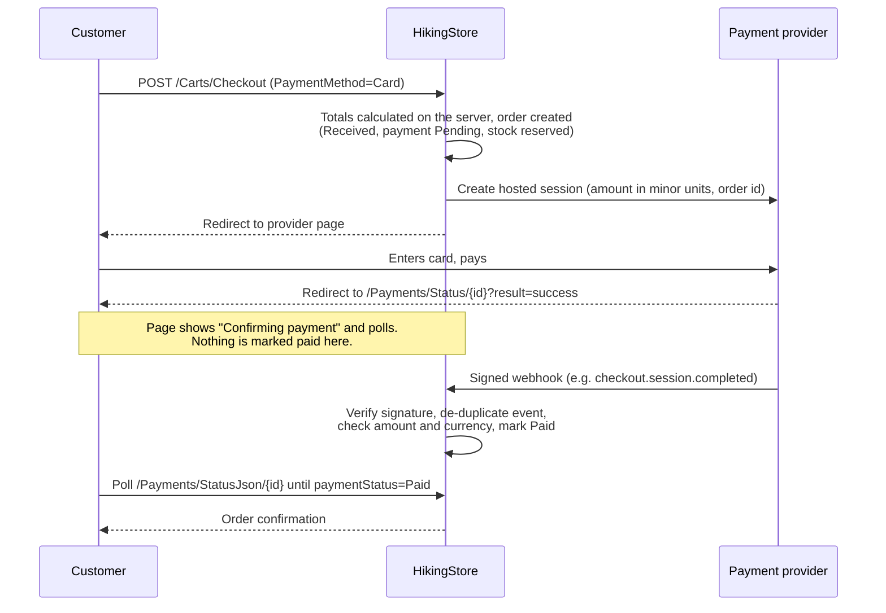

# Card payments

HikingStore accepts debit and credit cards through a **hosted payment page**. The customer types their card details on the provider's page (Stripe Checkout, or a bank's payment page), never on HikingStore. The application never receives, logs or stores card numbers, expiry dates or CVV codes. It only stores the provider's session and transaction references and the confirmed amount.

Cash on delivery and pay-at-pickup keep working alongside card payments, or on their own.

## How it works



Rules the code enforces:

- **Prices, discounts, shipping and totals are calculated on the server** (`OrderService.PlaceOrderAsync`), from current product prices and the coupon and shipping settings. The provider is asked to charge exactly `Order.TotalAmount`, sent as one line item in minor units (cents).
- **The order exists before payment.** It is created with `Status = Received`, `PaymentMethod = Card`, `PaymentStatus = Pending`, `PaymentProvider` set, and a payment deadline (`PaymentExpiresAt`). Stock is reserved at that moment, as for cash orders.
- **Only a signature-verified provider notification can mark an order paid.** Returning to the success URL only shows a "confirming" page that polls the server. A notification is applied only when the amount and currency match the order total. Otherwise the order goes to `RequiresReview` and staff are emailed.
- **Each provider event is applied once.** Every applied event is recorded in `PaymentEvents` with a unique `(Provider, EventId)` index, so retried or replayed deliveries return 200 without changing anything.
- **One live session per order.** Starting a new attempt closes the previous Stripe session first. Concurrent starts are resolved with an optimistic check on `PaymentAttempts`, and the loser closes the session it opened.
- **Unpaid card orders don't count.** They are excluded from revenue, dashboard counts, reports and review eligibility. Admins can't move them past *Received* until the payment is confirmed.

### Payment statuses

| `PaymentStatus` | Meaning | Order status |
|---|---|---|
| `Pending` | Waiting for the customer to pay (card) or for delivery (cash) | Received |
| `Paid` | Provider confirmed the full amount | Unchanged; staff process the order as usual |
| `Failed` | Provider reported a final failure (e.g. async payment failed) | Cancelled, stock restored |
| `Expired` | Payment window passed without payment | Cancelled, stock restored |
| `Cancelled` | Customer or staff cancelled before paying | Cancelled, stock restored |
| `RefundDue` | Money arrived for an order that was already cancelled, or staff cancelled a paid order | Cancelled; refund it in the provider dashboard |
| `RequiresReview` | Paid amount or currency doesn't match the order total, or a second payment arrived | Staff decide; see admin notes |
| `Refunded` | Provider reported a full refund | Unchanged |

A declined card (`payment_intent.payment_failed`) does **not** cancel the order. The reason is shown to the customer, who can try again with **Complete payment** until the deadline.

### Where customers see it

- **Checkout:** a "Credit or debit card" option, shown only when a provider is active, with a *Test mode* badge when using test credentials. The button reads **Continue to secure payment**.
- **`/Payments/Status/{id}`** has four states:
  - *Confirming your payment*: polls for about 3 minutes, then explains that confirmation can take longer.
  - *Awaiting payment*: **Pay €X securely** (retry) and **Cancel order**.
  - *Cancelled / expired / failed*: explains why.
  - *Needs attention*: for refund-due or review cases.
- **Order details** show **Complete payment** and **Cancel order** while awaiting payment. **Order confirmation** says *Total paid* and *nothing is due on delivery* once paid.
- **Cancelling** an unpaid card order closes the provider session first. If the provider reports the session is already complete, cancellation is refused. Otherwise the order is cancelled and stock is restored. When cancelled from the payment status page, the items are also put back in the cart.

### Background release of abandoned orders

`PendingPaymentSweeper` runs every 5 minutes. It finds card orders still `Pending` whose `PaymentExpiresAt` passed more than `ExpiryGraceMinutes` ago, and for each one asks the provider for the session state first:

- If the session shows a completed payment, the order is left for the webhook to settle.
- Otherwise the session is closed, the order is cancelled as `Expired` and its stock is released.

The customer is emailed only when `PublicBaseUrl` is set.

## Configuration

All settings live in the `Payments` section. **Secrets must not be committed.** `appsettings.json` only has empty placeholders. Supply real values through [user secrets](https://learn.microsoft.com/aspnet/core/security/app-secrets) in development and environment variables or a vault in production. In environment variables, `:` becomes `__`.

| Key | Default | Description |
|---|---|---|
| `Payments:CashOnDeliveryEnabled` | `true` | Offer cash on delivery / pay at pickup |
| `Payments:CardProvider` | `""` | `Stripe`, `HostedGateway`, or empty to disable cards |
| `Payments:PendingPaymentTimeoutMinutes` | `60` | Time the customer has to pay (clamped to 30–1440) |
| `Payments:ExpiryGraceMinutes` | `15` | Extra wait before the sweeper releases an expired order |
| `Payments:AllowTestModeInProduction` | `false` | Allow test keys when `ASPNETCORE_ENVIRONMENT=Production` (staging only) |
| `Payments:PublicBaseUrl` | `""` | Public site URL, e.g. `https://shop.example.com`. Used for links in emails sent from webhooks and the sweeper, and as the base for return and webhook URLs |
| `Payments:Stripe:SecretKey` | — | **Secret.** `sk_test_…`, `sk_live_…` or a restricted `rk_…` key. A publishable `pk_…` key is rejected |
| `Payments:Stripe:WebhookSecret` | — | **Secret.** `whsec_…` signing secret of the webhook endpoint |
| `Payments:Stripe:DisplayName` | `Credit or debit card` | Label on the checkout option |
| `Payments:HostedGateway:*` | — | See [Alternative provider](#alternative-provider-bank-or-processor-hosted-page) |

At startup the app logs either `Card payments enabled via {Provider} (test mode: …)` or `Card payments unavailable: {reason}`. If the configuration is invalid, card payments stay off; the app doesn't crash and doesn't fake anything. In **Production**, test-mode credentials are refused unless `AllowTestModeInProduction` is `true`.

The store currency comes from `Store:Currency` (default `EUR`) and is sent to the provider as is.

## Stripe

### Merchant account requirements

Stripe only onboards businesses that have a **legal entity and a bank account in a [Stripe-supported country](https://stripe.com/global)**. **Kosovo was not on that list** when this was written (check the page for the current list). Running Stripe in **live** mode therefore requires one of the following:

1. A company (and business bank account) registered in a supported country. Stripe Atlas, which forms a US company, is one route; check its eligibility for your residence.
2. Otherwise, use the [alternative provider](#alternative-provider-bank-or-processor-hosted-page) with a local bank or processor that offers e-commerce card acquiring.

Stripe also needs:

- business verification (KYC) and a website showing terms, privacy, returns and contact details (HikingStore already has these pages);
- a statement descriptor;
- card payments activated in the dashboard.

The live business must operate where the account is registered, and must comply with Stripe's restricted-business list.

**Test mode** works for anyone with a free Stripe account, whatever the country. It moves no real money.

Nothing in HikingStore simulates a successful payment. Without valid credentials the card option is hidden. If Stripe rejects a key, the customer sees "We couldn't connect to the payment provider" and the order stays unpaid.

### Test mode setup (development)

1. Create a Stripe account and stay in **Test mode**. Copy the secret key (`sk_test_…`) from *Developers → API keys*.
2. Install the [Stripe CLI](https://docs.stripe.com/stripe-cli) and run `stripe login`.
3. Start forwarding webhooks. Use the app's URL; the `http` profile is `http://localhost:5045`:

   ```bash
   stripe listen --forward-to http://localhost:5045/payments/webhooks/stripe
   ```

   The CLI prints a signing secret `whsec_…`.
4. Store the secrets from the project folder:

   ```bash
   dotnet user-secrets set "Payments:CardProvider" "Stripe"
   dotnet user-secrets set "Payments:Stripe:SecretKey" "sk_test_..."
   dotnet user-secrets set "Payments:Stripe:WebhookSecret" "whsec_..."
   ```

5. Run the app. Check the card option, which should carry a *Test mode* badge, and pay with a [Stripe test card](https://docs.stripe.com/testing):

   | Card | Result |
   |---|---|
   | `4242 4242 4242 4242` | Succeeds. Order becomes **Paid** after the webhook |
   | `4000 0000 0000 0002` | Declined. Customer sees the reason and can retry |
   | `4000 0025 0000 3155` | Requires 3-D Secure authentication |
   | `4000 0000 0000 9995` | Insufficient funds |

   Use any future expiry date, any CVC and any postcode.

6. Other scenarios to test:
   - **Cancel on Stripe's page:** you are returned to the status page; the order stays awaiting payment and can be retried or cancelled.
   - **Expiry:** set `PendingPaymentTimeoutMinutes` to `30`, leave a session unpaid, or run `stripe trigger checkout.session.expired`. The order is cancelled as **Expired** and its stock released.
   - **Duplicate events:** run `stripe events resend evt_…`. The second delivery is recorded as a duplicate and changes nothing.
   - **Refund** in the dashboard: the order becomes **Refunded** (full refunds only).

### Webhook endpoint (production)

In the Stripe dashboard (*Developers → Webhooks → Add endpoint*):

- **URL:** `https://<your-domain>/payments/webhooks/stripe`
- **Events:**
  - `checkout.session.completed`
  - `checkout.session.async_payment_succeeded`
  - `checkout.session.async_payment_failed`
  - `checkout.session.expired`
  - `payment_intent.payment_failed`
  - `charge.refunded`
- Put the endpoint's signing secret in `Payments__Stripe__WebhookSecret`.

The endpoint:

- verifies the `Stripe-Signature` header with `EventUtility.ConstructEvent`, with a 5-minute tolerance against replays;
- answers **400** to unsigned, tampered or stale requests, so Stripe retries them;
- answers **200** once an event has been applied or recognised as a duplicate.

Events whose `livemode` doesn't match the configured key are ignored. The endpoint allows anonymous access and is excluded from antiforgery checks; the signature is its authentication.

### What is sent to Stripe

A Checkout Session with:

- `mode=payment` and card as the only payment method;
- one line item `HikingStore order #<number>` for the server-calculated total;
- the customer email;
- `client_reference_id` and metadata `order_id` / `order_number`, set on both the session and the PaymentIntent;
- `expires_at`, kept within Stripe's 30-minute to 24-hour limits;
- the idempotency key `hikingstore-order-{id}-attempt-{n}`.

The SDK is the official `Stripe.net` package (version 53).

## Alternative provider (bank or processor hosted page)

`Payments:CardProvider = HostedGateway` sends the customer to a bank's or processor's **hosted payment page**. Banks in Kosovo and the region usually offer this with e-commerce acquiring. You need a merchant agreement for **card-not-present / e-commerce acquiring**, plus the processor's integration specification, test environment, merchant ID and signing key.

| Key | Description |
|---|---|
| `Payments:HostedGateway:DisplayName` | Name shown at checkout, e.g. the bank's name |
| `Payments:HostedGateway:MerchantId` | Merchant ID issued by the processor |
| `Payments:HostedGateway:PaymentPageUrl` | `https://` URL of the hosted payment page |
| `Payments:HostedGateway:SigningSecret` | **Secret**, at least 32 characters. Shared HMAC key |
| `Payments:HostedGateway:TestMode` | `true` while using the processor's test environment |
| `Payments:HostedGateway:NotificationToleranceSeconds` | Max age of a notification (default 600) |

The built-in protocol is a generic HMAC-SHA256 scheme.

**Signing.** Take every field except `signature`, sort the fields by name (ordinal), write each as `name=value`, and join them with `\n`. Sign that string with HMAC-SHA256 using `SigningSecret`. The signature is lowercase hex (`HostedGatewayPaymentProvider.BuildCanonicalString` / `ComputeSignature`).

**Redirect** is an auto-submitted form POST to `PaymentPageUrl` with these fields:

- `merchant_id`, `session_id` (`HS-{order}-{attempt}-{random}`), `order_id`
- `amount` in minor units, `currency`
- `description`, `email`
- `success_url`, `cancel_url`, `notify_url`
- `expires_at` and `timestamp` (Unix seconds), `test` (`1`/`0`)
- `signature`

**Notification.** The processor makes a server-to-server form-encoded POST to `notify_url`, which is `https://<domain>/payments/webhooks/hostedgateway`, with these fields:

- `merchant_id`, `event_id` (unique per notification), `session_id`, `order_id`, `transaction_id`
- `status`: one of `paid`, `pending`, `declined`, `failed`, `cancelled`, `expired`, `refunded`
- `amount` in minor units, `currency`, `reason`
- `timestamp` (Unix seconds), `test`
- `signature`

The signature is compared in constant time, and the merchant ID and timestamp window are checked. Duplicate field names are rejected.

Few processors use exactly these field names. When you receive the bank's specification, adapt `CreateSessionAsync`, `ParseNotification` and `BuildCanonicalString` in `Services/Payments/HostedGatewayPaymentProvider.cs`. Everything else (order states, de-duplication, amount checks, sweeper, UI) is shared and stays as it is. The generic protocol has no API to close a payment page early. A payment that lands on an order already cancelled therefore becomes **RefundDue** and staff are emailed.

The hosted gateway has only been tested with unit tests that sign and verify messages. It has **not** been tested against a real bank. Run the processor's test environment end to end before going live.

## Database

Migration `20261010184937_CardPayments` is purely additive and keeps all existing data:

- **New nullable `Orders` columns:**
  - `PaymentProvider`, `PaymentSessionId`, `PaymentTransactionId`
  - `PaidAmount`, `PaidAt`, `PaymentExpiresAt`
  - `PaymentFailureReason`
- **`Orders.PaymentAttempts`:** `int`, default `0`.
- **New `PaymentEvents` table:** `Provider`, `EventId`, `EventType`, `OrderId`, `ReceivedAt`, `Result`, with a unique index on `(Provider, EventId)`.
- **Indexes:** filtered indexes on `PaymentSessionId` and `PaymentTransactionId`, and an index on `(PaymentStatus, PaymentExpiresAt)` for the sweeper.

Existing orders keep their `PaymentMethod = CashOnDelivery` and status. The migration is applied at startup by `DbInitializer` like the earlier ones, or manually:

```bash
dotnet ef database update --context ApplicationDbContext
```

Back up the production database before deploying.

## Production checklist

1. Merchant account approved (Stripe in a supported country, or a bank acquiring agreement) and card payments activated.
2. Live credentials in environment variables or a vault: `Payments__CardProvider`, `Payments__Stripe__SecretKey` (`sk_live_…` or a restricted key) and `Payments__Stripe__WebhookSecret`. Never put them in `appsettings*.json` or JavaScript.
3. A live-mode webhook endpoint at `https://<domain>/payments/webhooks/stripe` with the six events above.
4. The site is served over **HTTPS**. `Payments__PublicBaseUrl` is set to the public URL. If the app sits behind a reverse proxy, configure forwarded headers so return URLs use the public host.
5. `Payments__AllowTestModeInProduction` is unset or `false`.
6. SMTP is configured so customers get payment emails and staff get "payment needs attention" alerts.
7. One full live transaction for a small amount, then a refund from the dashboard. Check that the order goes from Paid to Refunded.
8. Staff know the manual steps:
   - **RefundDue:** refund in the provider dashboard. The `charge.refunded` webhook then marks the order Refunded.
   - **RequiresReview:** compare the admin notes with the dashboard.

## Testing status

- **Automated:** `HikingStore.Tests/PaymentTests.cs` has 26 tests covering:
  - signature verification: valid, tampered, wrong secret, stale, unsigned;
  - mark-paid, duplicate events, amount mismatch, paid after cancellation, full refund;
  - declined, failed and expired notifications, with restock, and ignoring superseded sessions;
  - retry closing the previous session;
  - customer cancel with session close, and refusal when the session is complete;
  - sweeper release, and skipping when the provider reports the session paid;
  - registry rules (test keys in Production, invalid keys);
  - hosted-gateway signing.

  The second-payment and concurrent-start paths are implemented but not covered by tests.

  Run them with `dotnet test`.
- **Run locally against a copy of the database** with a placeholder test key:
  - checkout showed the card option;
  - the order was created as Pending, and the real Stripe API rejected the placeholder key, which the app handled;
  - signed webhooks were verified: unsigned, tampered, wrong-secret and stale requests got 400, and a valid one got 200;
  - the order was marked paid, and a duplicate delivery changed nothing;
  - the success return showed the confirmation only after the webhook.
- **Not yet run:** a real Stripe Checkout session with real test keys, the hosted gateway against a real bank, and the payment emails. Do these with your own test credentials before going live.
